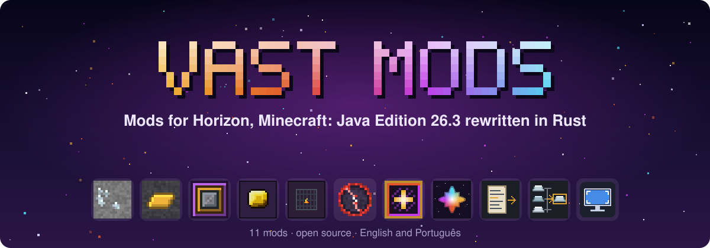
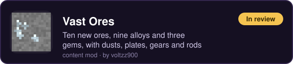
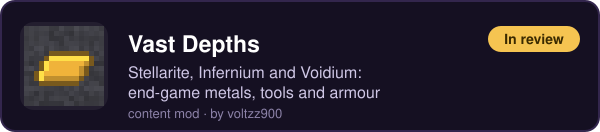
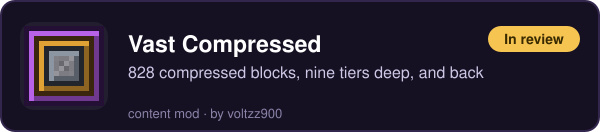

<b>English</b> · <a href="README.pt-BR.md">Português (Brasil)</a>

Our own mods for <a href="https://github.com/horizon-rust/horizon">Horizon</a>: ores and metals, adventure, end-game crafts and tools for modpack makers. Some are new ideas, some take a Java mod's idea and make it our own: new names, new art, built for Horizon.

## Mods

### ⛏️ World and materials

### ⚔️ Adventure

### ✨ Magic

### 🌟 End game

### 🛠️ For modpack makers

### 🖥️ Client

## What's next

- **3D items:** the cores, the star, the gems, the seals and the Ore Hammer get real shapes in the hand, on the ground and in frames (the inventory keeps their sprites).
- **Vast Spawners 0.2:** Jade lines for every spawner and a Spawner Modifiers category in Just Enough Items.
- More of the family: new mods that Horizon doesn't have yet.

## How to install

1. Open the **Horizon launcher** and go to **Mods**.
2. Find a Vast mod and press **Install**. A native mod also needs **Native build > Build**.
3. Start the game. A mod made of two halves (native + content) needs both installed.

Native mods are compiled into the game and are not sandboxed: build only code you trust. Every mod here is open source, and each repository's README says what its native half changes in the game.

## Source code

Each card opens the mod's own repository, with its README, releases, tools and licence (Vast Ores' repository holds Vast Depths too). The content mods are generated by a Python script in their `tools/`; the native mods are bundles for Horizon's native build.

## Found a bug?

Open an issue in that mod's repository: say what happened and how to make it happen again, and add a screenshot if you can. English or Portuguese.

## Credits

Made by **voltzz900**, under the MIT licence. Vast Adventures and Vast Spawners are built from the MIT code and data of Shadows_of_Fire's Apotheosis and Apothic Spawners; their repositories keep the notices. Not an official Minecraft product. Not approved by or associated with Mojang or Microsoft.
