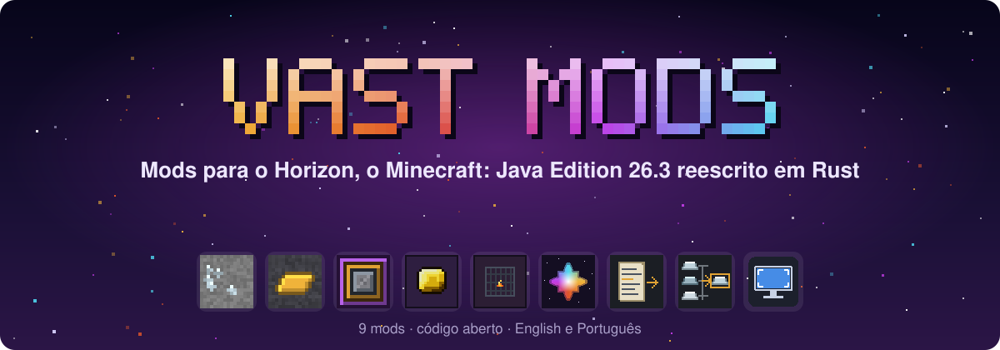
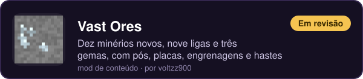
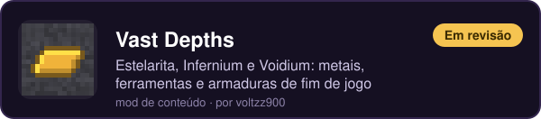
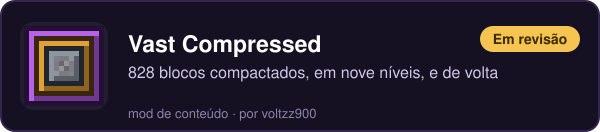
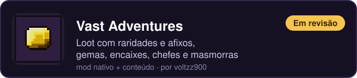
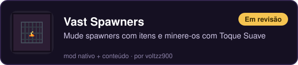
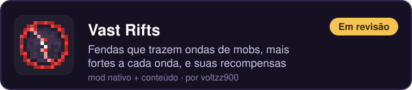
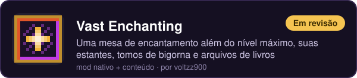
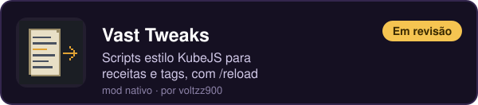
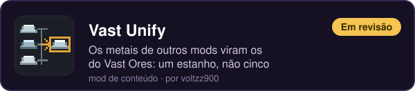

<a href="README.md">English</a> · <b>Português (Brasil)</b>

Nossos mods para o <a href="https://github.com/horizon-rust/horizon">Horizon</a>: minérios e metais, aventura, crafts de fim de jogo e ferramentas para quem monta modpacks. Alguns são ideias novas, outros pegam a ideia de um mod do Java e fazem do nosso jeito: nomes novos, arte nova, feitos para o Horizon.

## Mods

### ⛏️ Mundo e materiais

### ⚔️ Aventura

### ✨ Magia

### 🌟 Fim de jogo

### 🛠️ Para quem monta modpacks

### 🖥️ Cliente

## O que vem por aí

- **Itens 3D:** núcleos, estrela, gemas, selos e o Martelo de Minério ganham formas de verdade na mão, no chão e nas molduras (no inventário continuam os sprites).
- **Vast Spawners 0.2:** linhas do Jade para cada spawner e uma categoria Modificadores de Spawner no Just Enough Items.
- Mais da família: mods novos que o Horizon ainda não tem.

## Como instalar

1. Abra o **launcher do Horizon** e vá em **Mods**.
2. Ache um mod Vast e clique em **Install**. Mod nativo também precisa de **Native build > Build**.
3. Abra o jogo. Mod de duas metades (nativo + conteúdo) precisa das duas instaladas.

Mods nativos são compilados dentro do jogo e não ficam isolados: só compile código em que você confia. Todo mod aqui é código aberto, e o README de cada repositório diz o que a metade nativa muda no jogo.

## Código

Cada card abre o repositório do mod, com README, releases, ferramentas e licença (o repositório do Vast Ores também tem o Vast Depths). Os mods de conteúdo são gerados por um script Python no seu `tools/`; os nativos são bundles para o native build do Horizon.

## Achou um bug?

Abra uma issue no repositório do mod: diga o que aconteceu e como repetir, e mande um print se puder. Inglês ou português.

## Créditos

Feito por **voltzz900**, sob a licença MIT. Vast Adventures e Vast Spawners são feitos a partir do código e dos dados MIT do Apotheosis e do Apothic Spawners, de Shadows_of_Fire; os repositórios deles guardam os avisos. Não é um produto oficial do Minecraft. Não é aprovado pela Mojang ou pela Microsoft nem associado a elas.
